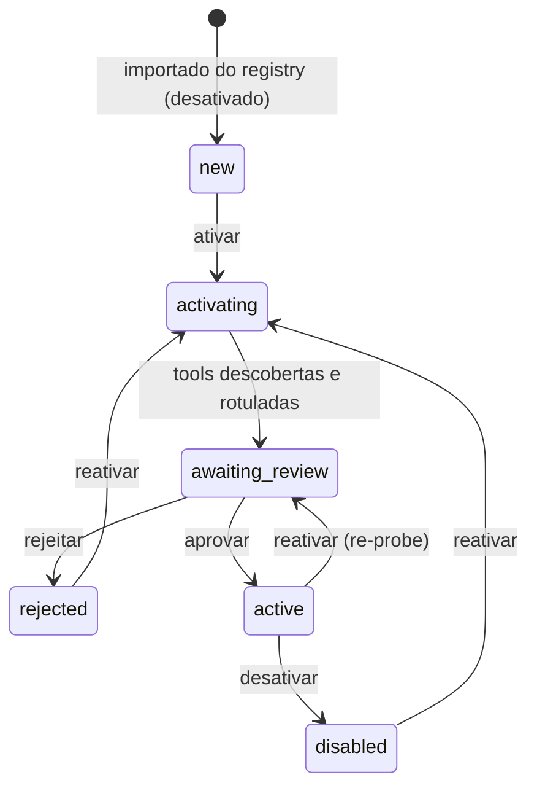
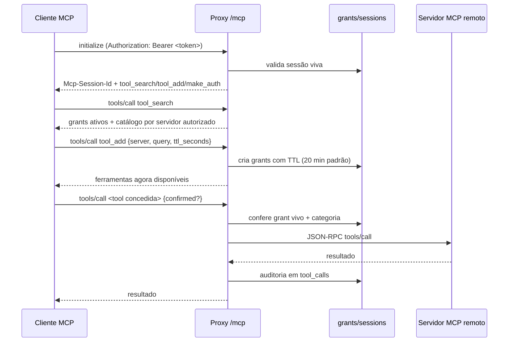

# mcpsec

Espelho local do [registry oficial de servidores MCP](https://registry.modelcontextprotocol.io)
com workflow de autorização por ferramenta, runner de execução estilo inspector
e um **proxy MCP** que expõe só as ferramentas liberadas a cada agente.
Backend **Rust (Loco + Sea-ORM + SQLite/Postgres)**, frontend **React (Vite)**.

## Funcionalidades

| Área | O que faz |
|---|---|
| **Autenticação** | Registro com verificação por e-mail, login JWT, recuperação de senha, magic link e reenvio de verificação. Rotas de app exigem sessão. Papéis: hoje todo usuário registrado é `admin` (`users.role`, `UserRole`); a arquitetura já separa o check para papéis menores futuros. |
| **Espelho do registry** | Sincroniza `GET /v0/servers?version=latest` paginando até o fim do cursor; novos servidores entram como `new` + desativados, existentes têm metadados atualizados. |
| **Sync agendado** | Scheduler dispara `registry_sync_tick` a cada minuto; a task decide se o intervalo configurado já venceu. Intervalo e `auto_sync_enabled` são runtime. |
| **Single-flight** | Uma linha `running` em `sync_runs` atua como lock com lease anti-travamento; syncs concorrentes são descartados, não duplicados. |
| **Workflow de ativação** | `new → activating → awaiting_review → active` (`rejected`/`disabled` como saídas). O worker conecta no MCP remoto, faz `initialize` + `tools/list` e sugere rótulos. |
| **Classificação de risco** | Cada tool recebe `READ_ONLY` (lê), `WRITE` (muda dados, incl. config/credenciais sensíveis) ou `ADMIN` (**executa**: comando/código/script ou apaga em massa de forma irreversível) por heurística (`classified_by=heuristic`), ajustável na revisão (`classified_by=user`). Re-syncs nunca sobrescrevem rótulo revisado; `cargo loco task relabel_tools` re-aplica a heurística nova às linhas ainda heurísticas. |
| **Runner (inspector)** | Só servidores `active`. Executa tool via proxy do backend com argumentos em JSON; READ_ONLY livre, WRITE/ADMIN exigem `confirmed: true`. |
| **Auditoria** | Toda chamada grava em `tool_calls`: argumentos, resultado, categoria, confirmação e duração; histórico por servidor nas últimas 50 chamadas. |
| **Proxy MCP** | Endpoint MCP (Streamable HTTP) em `POST /mcp` autenticado por bearer token de sessão, com superfície de ferramentas dinâmica. Sem sessão válida, expõe apenas `make_auth`, a ponte de autorização. |
| **make_auth** | Tool builtin que responde sem sessão: devolve a URL do painel (`/proxy`) para o humano logar, criar a sessão e copiar o bearer token. `APP_BASE_URL`/`PORT` controlam o host do link. |
| **Sessões e grants** | Sessões de proxy por usuário (máx. 10, revogáveis). `tool_add` libera ferramentas com TTL (padrão 20 min, máx. 24 h); grants expirados são coletados pelo tick. |
| **Guarda SSRF** | URLs remotas precisam ser `https` e não podem resolver para loopback, privado, link-local ou porta privada. |
| **Configurações** | URL do registry, intervalo de sync e auto-sync em `app_settings` (tela Configurações), com disparo manual de sync. |
| **Banco de dados** | SQLite por padrão. Migração em voo para Postgres na tela Configurações: schema criado e dados copiados numa transação (ids preservados, sequences resetadas), marcador gravado no SQLite e ativação no restart. Boot resolve `DATABASE_URL` → marcador → SQLite; se o Postgres marcado estiver inacessível, sobe em modo degradado (somente leitura) no SQLite antigo. |

## Como funciona

### Ciclo de vida do servidor



### Superfície dinâmica do proxy



### Detalhes de comportamento

- **Sync** é idempotente e só refresca campos do registry (nome, título,
  descrição, versão, `remote_url`, status, datas): nunca muda o lifecycle nem
  rótulos revisados. Um `activating` travado é simplesmente reprocessado.
- **Tick** roda a cada minuto no cron estático, mas a cadência real vem de
  `app_settings`; mudar o intervalo não exige restart. Sync atrasado é
  recuperado no próximo tick.
- **Revisão**: `tools/list` substitui o conjunto local de tools (tools
  removidas no remoto são apagadas); o schema é sempre atualizado, o rótulo
  humano é preservado.
- **Runner**: `POST /api/mcp/{id}/tools/{name}/call` exige servidor `active`,
  aplica a guarda por categoria e grava auditoria com duração.
- **Proxy**: além da guarda por categoria (WRITE muda dados e ADMIN executa
  comandos/código; ambos pedem `{"confirmed": true}` nos argumentos), cada
  chamada só é permitida se existir um grant vivo. Grants expiram com folga
  de 5 minutos antes do GC.
- **Segurança de saída**: toda conexão remota passa por guarda SSRF
  (https-only, sem loopback/privado/link-local).

## API

| Método | Rota | Descrição |
|---|---|---|
| POST | `/api/auth/register` · `/login` · `/forgot` · `/reset` | Registro, login, recuperação |
| GET | `/api/auth/verify/{token}` · `/magic-link/{token}` · `/current` | Verificação, magic link, sessão atual |
| POST | `/api/auth/magic-link` · `/resend-verification-mail` | Solicitar magic link / reenviar verificação |
| GET | `/api/servers/` · `/api/servers/{id}` · `/api/servers/authorized` | Lista paginada, detalhe, servidores executáveis |
| POST | `/api/servers/{id}/activate` · `/approve` · `/reject` · `/disable` | Etapas do workflow |
| POST | `/api/servers/{id}/tools/{tool_id}/label` | Reclassificar categoria de uma tool |
| POST | `/api/mcp/{server_id}/tools/{tool_name}/call` | Executar tool (guarda + auditoria) |
| GET | `/api/mcp/{server_id}/history` | Últimas chamadas auditadas |
| GET/PUT | `/api/settings/` | Ler/atualizar URL do registry, intervalo, auto-sync |
| GET | `/api/settings/database` | Banco em uso, URI mascarada, flags de restart/degradado |
| POST | `/api/settings/database` | Migrar SQLite → Postgres (copia + marca; ativa no restart) |
| GET | `/api/sync/` · POST `/api/sync/run` | Status do sync e disparo manual |
| POST | `/mcp/` | Endpoint MCP (Streamable HTTP, bearer token) |
| POST/GET | `/api/proxy/sessions` | Criar (token exibido uma vez) / listar sessões |
| DELETE | `/api/proxy/sessions/{id}` | Revogar sessão |
| GET/POST | `/api/proxy/sessions/{id}/tools` | Snapshot das tools / conceder tools |
| GET | `/api/proxy/me` | Quem sou eu neste token |

## Telas

`/registry` (lista e filtros) · `/server/:id` (detalhe) · `/review/:id`
(revisão de tools e rótulos) · `/runner` (execução estilo inspector) ·
`/proxy` (sessões e grants) · `/docs` (como conectar um agente, com JSON de
configuração MCP) ·
`/settings` (registry e sync).

## Rodando

```sh
# backend + workers + scheduler (dev)
DB_MIN_CONNECTIONS=2 DB_MAX_CONNECTIONS=4 cargo loco start --all

# frontend (dev server com proxy /api)
cd frontend && npm run dev        # http://localhost:5173

# ou build servido pelo próprio Loco
cd frontend && npm run build      # Loco serve frontend/dist
```

Primeiro acesso: registre um usuário em `/register`, faça login, vá em
**Configurações** e dispare **Sincronizar agora**.

Também é possível sincronizar por CLI:

```sh
cargo loco task registry_sync
```

## Testes

```sh
cargo fmt --all
cargo clippy --all-targets -- -D warnings
cargo test                        # também regenera frontend/src/bindings
cd frontend && npm run build
```

## Estrutura

```text
src/controllers/   auth, servers, settings, sync, mcp (runner), proxy, proxy_admin
src/models/        mcp_servers, mcp_tools, sync_runs, tool_calls, app_settings,
                   mcp_proxy_sessions, mcp_proxy_grants
src/workers/       registry_sync (+ client), activation, mcp (cliente MCP)
src/tasks/         registry_sync, registry_sync_tick, user_create, user_delete
frontend/src/      pages, api client, bindings (gerados por ts-rs)
```
